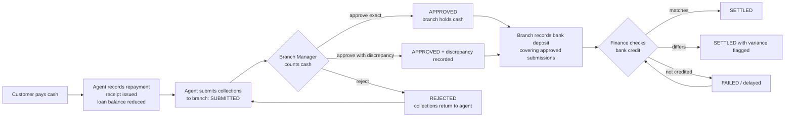
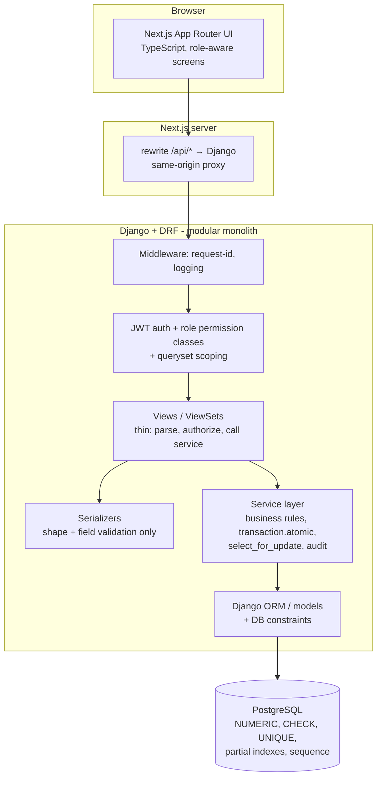
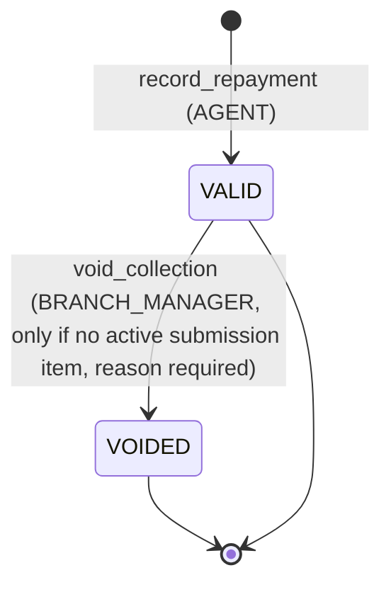
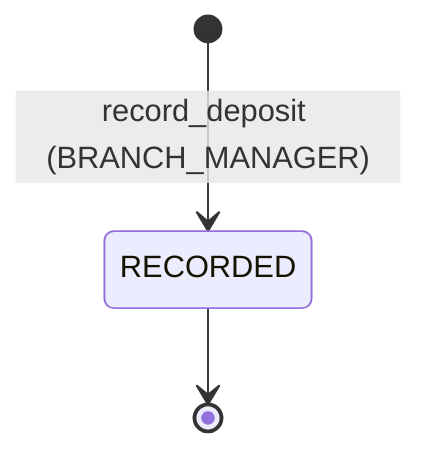

# CMRS — Cash Management & Reconciliation System: System Design Document (v0.1, for review)

Tags used throughout:
**[REQ]** stated in the assignment · **[REC]** my recommendation (design choice) · **[ASM]** assumption you must confirm.

---

## 1. Problem definition & scope

**Business problem.** Customers repay loans in cash to field agents. Cash then physically travels agent → branch → bank → company account. Each hop can lose, delay or mis-record money. CMRS gives every rupee a traceable path and makes each hand-over explicit, verified, and auditable. [REQ]

**Two lifecycles — never conflate them.**

| | Loan-accounting lifecycle | Physical cash-movement lifecycle |
|---|---|---|
| Question answered | "What does the customer still owe?" | "Where is the money right now?" |
| Event | Agent records repayment, receipt issued | Submitted → Branch received → Deposited → Settled |
| Changes when | Customer pays | Cash changes hands |
| Owned by | `lending` / `collections` | `cash` / `treasury` |

A repayment is *accounted* the moment the agent records it (customer gets a receipt, loan balance drops) even though the cash is still in the agent's pocket. A bank deposit being *recorded* is not *settled*; settlement is the bank/company confirming the money arrived.

**Worked example (INR).** Agent Ravi collects from 5 customers on Monday: ₹10,000 + ₹12,000 + ₹8,000 + ₹15,000 + ₹5,000 = **₹50,000**.
1. Each repayment is recorded → 5 receipts, 5 loan balances reduced. Cash with agent: ₹50,000.
2. Ravi submits all 5 to Branch Manager Meena. Expected = ₹50,000 (system-computed from the 5 collections; Ravi cannot type it). Status `SUBMITTED`. Cash "in transit".
3. Meena counts ₹48,500. She enters received = ₹48,500 → **discrepancy ₹1,500 (shortfall)**, reason mandatory. She can *approve with discrepancy* (₹48,500 is now branch cash; ₹1,500 is an open discrepancy against Ravi) or *reject* (collections return to Ravi, who must resubmit).
4. Meena deposits ₹48,500 at HDFC, ref `UTR998877`. Deposit recorded, settlement `PENDING`.
5. Finance sees the credit in the company account → confirms settlement ₹48,500. If the bank credited ₹48,000, ₹500 variance is flagged.
Dashboard funnel: Expected ₹50,000 → Collected ₹50,000 → Branch received ₹48,500 → Deposited ₹48,500 → Settled ₹48,500; discrepancy ₹1,500.

**In scope [REQ]:** customers, loans, schedules, outstanding/history; agent collection with partial payments, unique receipts, daily view; submission to branch; branch reconciliation with discrepancy + approve/reject; bank deposits; settlement tracking and mismatch detection; dashboards with date/branch/agent/status filters; auth + RBAC; the nine "important business cases"; README/hosting/test credentials/5-min video.

**Out of scope [REC]:** loan origination/disbursement, interest accrual engines, late fees, customer self-service portal, payment gateway (optional; see §13), multi-currency, notifications, real bank-feed integration.

---

## 2. User roles & permissions

The assignment leaves roles undefined. **[ASM]** Four roles:

| Role | Scope | Responsibilities |
|---|---|---|
| `AGENT` | own customers only | view assigned customers; record repayments; view own daily collections; submit cash to branch; view own submissions & statuses |
| `BRANCH_MANAGER` | own branch only | manage customers/loans/agent assignment in branch; view agent collections; reconcile (approve/reject) submissions; record bank deposits; branch summaries |
| `FINANCE` | all branches, read + settlement | confirm/fail settlements; view all deposits & mismatches; company-wide dashboards |
| `ADMIN` | everything, master data | manage users & branches; read-only on financial transactions (cannot approve/settle) |

Why `FINANCE` separate: settlement = "Company Account" confirmation. The person who deposits cash (branch) should not also confirm it arrived (segregation of duties / maker-checker). Likewise an agent can never approve their own submission, and `ADMIN` is deliberately not a financial "super-approver".

Permission matrix (✔ = allowed within scope):

| Action | AGENT | BRANCH_MGR | FINANCE | ADMIN |
|---|:-:|:-:|:-:|:-:|
| CRUD users/branches | | | | ✔ |
| CRUD customers/loans, assign agent | | ✔ (branch) | | ✔ |
| View customers/loans/history | ✔ (assigned) | ✔ (branch) | ✔ (read) | ✔ (read) |
| Record repayment | ✔ (assigned customers) | | | |
| Void uncommitted collection | | ✔ | | |
| Submit cash | ✔ (own) | | | |
| Approve/reject submission | | ✔ (not own, branch) | | |
| Record bank deposit | | ✔ (branch) | | |
| Confirm/fail settlement | | | ✔ | |
| Dashboards | own | branch | all | all |
| View audit trail | | branch (read) | ✔ | ✔ |

Enforcement: DRF permission classes (role) + queryset scoping (branch/agent) in one shared mixin. Frontend hides what you can't do (usability only); backend is the authority.

---

## 3. End-to-end business workflow



A typical day per user:
- **Agent**: morning – view assigned customers with due installments; day – record repayments (partial allowed), print/see receipts; evening – review "cash I'm holding", submit to branch; next day – check approved/rejected.
- **Branch Manager**: receives agents physically, counts, enters received amount, approves/rejects; batches approved cash into a bank deposit; monitors branch summary & discrepancies; sets up customers/loans.
- **Finance**: daily bank-statement check; confirms settlements; chases deposits pending > threshold; reviews variances.
- **Admin**: onboarding users/branches.

What can go wrong at each stage:

| Stage | Failure | System response |
|---|---|---|
| Repayment | double-tap / retry; amount > outstanding; two payments racing | idempotency key; over-collection rule; loan row lock |
| Agent submission | same collection submitted twice; submits another agent's cash | partial unique index + row locks; ownership check |
| Reconciliation | counted ≠ expected; manager approves twice; edits after approval | discrepancy record; row lock + state check; immutability |
| Deposit | same bank reference twice; deposit ≠ reconciled total; deposit of unapproved cash | unique reference; variance flagged; only APPROVED submissions eligible |
| Settlement | bank didn't credit; credited less; delayed | FAILED state with retry; variance; "delayed" derived from age |

---

## 4. Requirements extracted

### Functional [REQ]
- FR1 Auth + RBAC. FR2 Customer & loan CRUD. FR3 repayment schedule per loan. FR4 outstanding amount & repayment history per loan.
- FR5 Agent: view assigned customers; record repayment; partial payments; unique receipt numbers; daily collections; submit to branch.
- FR6 Branch manager: view agent collections; verify received; expected vs actual; record discrepancy; approve/reject; branch summaries.
- FR7 Deposits against reconciled cash; capture bank, amount, date, reference; track settlement status; show branch-reconciled vs bank-settled difference.
- FR8 Dashboards: expected, collected, held by agents, received at branches, deposited, settled, outstanding, discrepancies; filters date/branch/agent/status.
- FR9 Handle: partial repayment, over-collection, duplicate collection, discrepancy, rejected submission, deposit mismatch, duplicate bank reference, unauthorized modification of reconciled records, failed/delayed settlement.
- FR10 Document assumptions.

### Non-functional [REQ + REC]
- Decimal/NUMERIC for money, no floats [REQ]. Next.js/React, Django+DRF, PostgreSQL, REST, JWT or secure sessions, RBAC, Git/GitHub [REQ].
- NFR: atomicity of multi-row financial writes; no lost updates under concurrency; append-only audit trail; immutable reconciled records; consistent error format; OpenAPI docs; automated tests of financial invariants; secure config (secrets in env, HTTPS, CORS minimal); reproducible setup (README).
- Deliverables [REQ]: GitHub repo (code, README, setup, env var docs, schema info, API docs), public hosted URL, test credentials per role, ≤5-min video covering the ten listed topics.
- Evaluation weights [REQ]: Functionality 25 · Architecture 20 · DB 15 · Code quality 15 · UI/UX 10 · Security/errors 10 · Docs 5. → Plan effort accordingly: **business logic and DB design are 40% of the grade; polish is 10%.**

---

## 5. Architecture

**Decision [REC]: modular monolith** — one Django project, domain apps with one-way dependencies, a service layer for all money-moving logic. Next.js is a separate deployable. No microservices/event sourcing/CQRS: one team, one database, strong transactional consistency needed across lifecycle steps (a distributed design would make "atomic across collections + submission" *harder*). Revisit only if separate teams, independent scaling of reporting, or bank-integration workloads appear.



**Responsibilities**
- *Frontend*: presentation, form UX validation (fast feedback), routing guards, role-aware navigation. Never authoritative. Never computes balances.
- *Backend*: authN/Z, all validation of record, business rules, state transitions, transactions, audit, reporting queries.
- *Database*: last line of defense: types, NOT NULL, CHECK, UNIQUE, FK, partial unique indexes, sequence for receipts.

**Request flow:** Browser → Next `/api/*` rewrite (same origin) → Django middleware → JWT auth → permission class → view → serializer (shape) → service (rules, in `atomic`) → ORM → Postgres → serializer → JSON (decimals as strings).

**Auth [REC]:** `djangorestframework-simplejwt`. Short-lived access token (15 min) returned in JSON and kept **in memory** by the client; refresh token (e.g. 8 h, rotating, blacklisted on logout) in an **httpOnly, Secure, SameSite=Lax cookie** set by Django. Because Next proxies `/api/*` (same origin), no third-party-cookie issue and CORS is practically unnecessary. Trade-off: one extra proxy hop; benefit: no tokens in localStorage (XSS-resistant), no CSRF-sensitive cookie auth on API calls (access token is a Bearer header; refresh endpoint additionally CSRF-guarded by SameSite + custom header). Alternative (Django sessions + CSRF) is also acceptable [REQ] but is awkward across Vercel/Render domains.

**Business logic location [REC]:** `services.py` per app. Views never touch state fields; serializers never contain rules like "can this be approved". Everything with a state change = a service function = one transaction = one audit event.

**Transactions:** `ATOMIC_REQUESTS=False` (explicit): each service function wraps its work in `transaction.atomic()`, so the boundary is visible and testable. Audit events are written inside the same transaction (rolled back with the operation — no phantom audit rows, no unaudited changes).

**Protecting financial records:**
1. No generic update/delete endpoints on financial models (only action endpoints).
2. Services check state before mutating; model `save()`/`delete()` on money tables reject changes when the row is in a terminal state (defense in depth for admin shell/serializer bugs).
3. DB CHECK constraints for legal combinations of status/fields.
4. Django admin: financial models read-only.
5. Optional hardening (P3): Postgres trigger forbidding UPDATE of amount columns on `APPROVED` submissions. Say so honestly in the video rather than overclaim.

**Errors:** one envelope `{"code": "OVER_COLLECTION", "message": "...", "details": {...}, "request_id": "..."}`. Custom DRF exception handler maps domain exceptions (`DomainError` subclasses) → 400/403/404/409. Unexpected → 500 with request_id, logged with stack trace, no internals leaked. Failed transaction = full rollback, nothing partial.

**Reporting:** computed on read with aggregate queries (`SUM ... FILTER`, `GROUP BY`) in `reporting/selectors.py`; no materialized tables, no Celery. Volume for this assignment is tiny; indexes suffice. Revisit with materialized views if volume grows.

**Optional tech verdicts [REC]**

| Tech | Verdict | Why |
|---|---|---|
| Docker / docker-compose | **Yes** (small) | Solves concrete problem: reviewers run Postgres+API+UI with one command; also the backend deploy image |
| Redis / Celery | **No** | No async work. "Delayed settlement" is a derived query, not a scheduled job |
| Pytest | **No** (your decision) | No automated test suite; correctness relies on DB constraints, locking, and manual verification (§12) |
| drf-spectacular (OpenAPI/Swagger) | **Yes** | Required API docs, near-free |
| GitHub Actions CI | **No** (your decision) | Nothing to run; Git + GitHub only for version control |
| Structured logging | **Yes** (stdlib + request-id) | Cheap; Sentry optional |
| Payment gateway sandbox | **Defer** | Optional; only after core is solid (§13) |
| UI library | **Tailwind + shadcn/ui** (or plain Tailwind) | Fast, accessible tables/dialogs; avoid custom design time (UI is 10%) |

---

## 6. Modules

### Backend Django apps (dependency direction: left depends on nothing to its right)

```
common  ←  accounts  ←  lending  ←  collections  ←  cash  ←  treasury
   ↑          ↑                                                  ↑
 audit ───────┴────── (called by all services)     reporting (read-only over all)
```

| App | Owns (tables) | Responsibility / key rules | Main services |
|---|---|---|---|
| `common` | — | `Money` helpers (Decimal quantize, 2dp), `DomainError`s, pagination, exception handler, permission base classes, idempotency helper | — |
| `accounts` | `roles`, `users`, `branches` | Custom user (`role` FK, `branch` FK), login/refresh/logout/me, role permissions, branch scoping mixin | `create_user`, `deactivate_user` |
| `audit` | `audit_events` | Append-only event store; `audit.record(actor, action, entity, before, after)` | `record` |
| `lending` | `customers`, `loans`, `installments` | Customer/loan CRUD, schedule generation, outstanding calc, agent assignment, loan close | `create_loan_with_schedule`, `get_outstanding`, `assign_agent` |
| `collections` | `collections` | Record repayment (idempotent, locked), receipt numbers, daily view, void | `record_repayment`, `void_collection` |
| `cash` | `cash_submissions`, `cash_submission_items` | Agent→branch submission; reconciliation (approve/reject, discrepancy) | `submit_cash`, `approve_submission`, `reject_submission` |
| `treasury` | `bank_deposits`, `settlements` | Deposit against approved submissions; settlement confirm/fail; mismatch | `record_deposit`, `confirm_settlement`, `fail_settlement` |
| `reporting` | none | Dashboard metrics, branch summary, lifecycle trace, CSV export | selectors only |

Why this boundary: `lending` knows nothing about cash. `collections` calls `lending` services (lock loan, outstanding) — never the reverse. `cash` references `collections` by FK and calls `collections` selectors; `treasury` references `cash` submissions. Communication = direct service-function calls in one direction, inside the caller's transaction. **No Django signals for money logic** (hidden control flow, hard to test). If an upward notification is ever needed, the lower layer returns data and the caller acts.

Operations that **must** be services (never view/serializer): record repayment, void, submit cash, approve/reject, record deposit, confirm/fail settlement, loan creation (schedule generation), agent reassignment.

### Frontend feature modules (`src/features/*`)
`auth`, `customers`, `loans`, `collections`, `submissions` (agent side), `reconciliation` (manager side), `deposits`, `settlements`, `dashboard`, `audit`, `admin` (users/branches). Each: `api.ts` (typed calls), `types.ts`, `schemas.ts` (zod), `components/`, hooks.

Per-module detail (APIs in §9, verification in §12, screens in §10):

| Module | Business rules enforced | Dependencies |
|---|---|---|
| accounts | agent/manager must have a branch; manager can't act outside branch; deactivated users cannot log in | — |
| lending | customer's agent belongs to the same branch; schedule sums exactly to `total_payable`; loan outstanding ≥ 0; no edit of principal/schedule after first collection | accounts |
| collections | amount > 0; agent owns customer; loan ACTIVE; amount ≤ outstanding (over-collection rule); receipt unique; idempotent; immutable after creation (void only if not submitted) | lending, accounts, audit |
| cash | only own, VALID, un-submitted collections; submission non-empty; expected computed server-side; received ≥ 0; discrepancy reason required if ≠ 0; reject reason required; approver ≠ submitter, same branch; terminal after approval | collections |
| treasury | only APPROVED, un-deposited submissions of the same branch; reference unique; variance reason if deposit ≠ reconciled total; settlement only by FINANCE; FAILED may be retried | cash |

---

## 7. Database design

### Table inventory — with keep/merge/drop reasoning

| Candidate | Decision | Reason |
|---|---|---|
| roles | **Keep (new, per your decision)** — small lookup table seeded with the 4 roles | `users.role_id` is a real FK, so roles are data-integrity-checked by the DB and new roles need no schema change. Permissions stay in code, keyed by `roles.code` (no Permission table) |
| users | Keep (custom `AbstractUser`) with `role` FK + `branch` FK | |
| branches | Keep | |
| customers | Keep (`branch`, `assigned_agent` FK) | |
| loans | Keep | |
| repayment_schedules | Keep as `installments` (one row per installment) | |
| collections | Keep | The ledger of repayments; source of truth for balance |
| cash_submissions | Keep | Also carries reconciliation outcome |
| cash_submission_items | Keep | Links submission ↔ individual collections; enforces "no double submit" via partial unique index |
| reconciliation_records | **Merge into `cash_submissions`** | Reconciliation is 1:1 with a submission (one count per submission; rejection → new submission). Separate table adds a join and an inconsistency risk without new information |
| bank_deposits | Keep | |
| deposit_allocations | **Drop; use `cash_submissions.deposit_id` FK** | A deposit covers *whole* approved submissions (many-to-one). Allocation table only needed to split one submission across several deposits — not required; documented limitation + upgrade path |
| settlements | Keep (1:1 with deposit) | Different actor/time/amount (bank-credited amount) than the deposit; enables variance detection |
| audit_events | Keep | |

### Transactional records vs calculated balances [REC]
- **Source of truth**: immutable-ish ledger rows (`collections`, `cash_submissions`, `bank_deposits`, `settlements`).
- **Outstanding balance is never stored.** `outstanding = loan.total_payable − SUM(collections.amount WHERE status='VALID')`. At this scale a `SUM` with index `(loan_id)` is trivially fast, and it cannot drift. Correctness under concurrency comes from locking the loan row during the write, not from a cached counter.
- **Installment status is derived** by an oldest-first waterfall of total paid over installments (service/selector function): paid ₹7,000 with installments of ₹5,000 → #1 PAID, #2 PARTIAL (₹2,000 of 5,000), others PENDING/OVERDUE. No allocation table: payments are fungible against the loan; a partial payment is simply a smaller `collections` row.
- **Cash-location is derived**, not stored: with agent = valid collection with no active submission item; in transit = active item in `SUBMITTED` submission; branch cash = `APPROVED` submission with no deposit (amount = `received_amount`); deposited = submission has deposit, settlement `PENDING`; settled = settlement `SETTLED`. This avoids a denormalized `status` on `collections` that could disagree with the submission tables. The only stored status on `collections` is the accounting one (`VALID`/`VOIDED`).
- **Snapshots are stored where history matters**: `expected_amount`, `received_amount`, `discrepancy_amount` on a submission; `expected_amount` and `variance` on a deposit — these must not change if later data changes.

### Tables (all money = `NUMERIC(14,2)` / `DecimalField(max_digits=14, decimal_places=2)`; all timestamps `timestamptz`; PKs `bigint` identity; display refs are separate unique columns)

**branches** — `id`, `code` (UQ), `name`, `is_active`.

**roles** — `id`, `code` (UQ; `AGENT`, `BRANCH_MANAGER`, `FINANCE`, `ADMIN`), `name`, `description`. Seeded by a data migration; rows are never deleted while referenced (`on_delete=PROTECT`). Application permission checks compare `user.role.code` against constants.

**users** — `id`, `username` (UQ), `email`, `password`, `full_name`, `role_id` FK→roles (NOT NULL, PROTECT), `branch_id` FK→branches (null only for FINANCE/ADMIN). Rule: role code in (AGENT, BRANCH_MANAGER) ⇒ branch not null — cross-table, so enforced in the service layer (`create_user`/`update_user`), not a CHECK. Index `(branch_id, role_id)`. Use `select_related('role')` on auth to avoid an extra query per request.

**customers** — `id`, `customer_code` (UQ), `full_name`, `phone`, `address`, `branch_id` FK, `assigned_agent_id` FK→users (nullable), `is_active`. Indexes: `(assigned_agent_id)` (agent's list), `(branch_id)`, trigram/`lower(full_name)` search (optional). Validation: agent.branch = customer.branch (service-level; cross-table, so not a CHECK).

**loans** — `id`, `loan_number` (UQ), `customer_id` FK, `principal` NUMERIC, `total_payable` NUMERIC (principal + interest, fixed at creation [ASM]), `installment_count`, `frequency` ∈ {WEEKLY, MONTHLY}, `start_date`, `status` ∈ {ACTIVE, CLOSED}, `created_by`. CHECK: `total_payable >= principal > 0`, `installment_count > 0`. Index `(customer_id)`, `(status)`.

**installments** — `id`, `loan_id` FK, `installment_no`, `due_date`, `amount_due` NUMERIC. UQ `(loan_id, installment_no)`. CHECK `amount_due > 0`. Index `(due_date)`, `(loan_id, due_date)` (expected-collections query). Invariant (service + test): `SUM(amount_due) = loan.total_payable` — the last installment absorbs rounding remainder (Decimal arithmetic, `ROUND_HALF_UP`).

**collections** — `id`, `receipt_number` (UQ), `loan_id` FK, `agent_id` FK, `branch_id` FK (snapshot at collection time), `amount` NUMERIC, `collected_at`, `collection_date` (date, IST), `status` ∈ {VALID, VOIDED}, `idempotency_key` UUID, `request_hash`, `note`, `voided_by`, `voided_at`, `void_reason`.
- CHECK `amount > 0`. UQ `(agent_id, idempotency_key)`. UQ `receipt_number`.
- CHECK status=VOIDED ⇒ void_reason NOT NULL.
- Indexes: `(loan_id)` (balance/history), `(agent_id, collection_date)` (daily view), `(branch_id, collection_date)` (branch summary).
- Receipt number: from a Postgres `SEQUENCE` (`receipt_seq`, created in a migration), formatted `RCP-<branchcode>-<YYYYMMDD>-<seq 6 digits>`. Sequences are concurrency-safe and need no lock; gaps after rolled-back transactions are acceptable [ASM] (call out in docs; uniqueness, not gaplessness, is required).

**cash_submissions** — `id`, `reference_no` (UQ), `agent_id`, `branch_id`, `submitted_at`, `status` ∈ {SUBMITTED, APPROVED, REJECTED}, `expected_amount` (sum of items, snapshot), `received_amount` (null until reviewed), `discrepancy_amount` (= expected − received; + shortfall, − surplus), `discrepancy_reason`, `reviewed_by`, `reviewed_at`, `rejection_reason`, `deposit_id` FK→bank_deposits (null), `idempotency_key`.
- CHECK: `status='APPROVED'` ⇒ received, discrepancy, reviewed_by, reviewed_at NOT NULL, and `discrepancy_amount = expected_amount − received_amount`.
- CHECK: `status='REJECTED'` ⇒ rejection_reason NOT NULL, received NULL.
- CHECK: `deposit_id` NOT NULL ⇒ status='APPROVED'.
- CHECK: discrepancy ≠ 0 ⇒ `discrepancy_reason` NOT NULL.
- UQ `(agent_id, idempotency_key)`. Indexes: `(branch_id, status)` (pending queue), `(agent_id, submitted_at)`, `(deposit_id)`.

**cash_submission_items** — `id`, `submission_id` FK, `collection_id` FK, `amount` (snapshot), `is_active` bool.
- **Partial unique index**: `UNIQUE (collection_id) WHERE is_active` → a collection can be in at most one live submission. On rejection the service sets `is_active=false` (rows kept for history), freeing collections for resubmission.
- Index `(submission_id)`.

**bank_deposits** — `id`, `deposit_no` (UQ), `branch_id`, `bank_name` (from fixed list), `amount` NUMERIC, `deposit_date`, `reference_number`, `reconciled_amount` (snapshot: sum of linked submissions' received), `variance_amount` (= amount − reconciled), `variance_note`, `created_by`, `created_at`.
- **UQ on `UPPER(TRIM(reference_number))`** (functional unique constraint; globally unique [ASM: bank refs are unique identifiers]) → duplicate bank reference impossible even under races.
- CHECK `amount > 0`; CHECK variance ≠ 0 ⇒ variance_note NOT NULL; CHECK `deposit_date` not in future (app-level, since depends on "today").
- Index `(branch_id, deposit_date)`.

**settlements** — `id`, `deposit_id` FK **UNIQUE** (1:1, created `PENDING` in the same transaction as the deposit), `status` ∈ {PENDING, SETTLED, FAILED}, `settled_amount` (null until SETTLED), `settled_on`, `bank_credit_reference`, `variance_amount` (= deposit.amount − settled_amount), `variance_note`, `failure_reason`, `confirmed_by`, `confirmed_at`.
- CHECK: SETTLED ⇒ settled_amount, settled_on, confirmed_by NOT NULL; FAILED ⇒ failure_reason NOT NULL; variance ≠ 0 ⇒ note.
- Index `(status)`. "Delayed" = `PENDING` where deposit_date older than configurable threshold (default 2 business days [ASM]) — computed at query time; no scheduler.

**audit_events** — `id`, `occurred_at`, `actor_id` (null for system), `actor_role`, `action` (e.g. `SUBMISSION_APPROVED`), `entity_type`, `entity_id`, `before` JSONB, `after` JSONB, `reason`, `request_id`, `ip`. Append-only: no update/delete endpoints; model `save` forbids modifying an existing row. Indexes `(entity_type, entity_id)`, `(occurred_at)`.

### ER diagram

```mermaid
erDiagram
  ROLE ||--o{ USER : "assigned to"
  BRANCH ||--o{ USER : employs
  BRANCH ||--o{ CUSTOMER : serves
  USER ||--o{ CUSTOMER : "assigned agent"
  CUSTOMER ||--o{ LOAN : has
  LOAN ||--|{ INSTALLMENT : "scheduled as"
  LOAN ||--o{ COLLECTION : "repaid by"
  USER ||--o{ COLLECTION : "collected by"
  BRANCH ||--o{ COLLECTION : "snapshot branch"
  USER ||--o{ CASH_SUBMISSION : submits
  CASH_SUBMISSION ||--|{ SUBMISSION_ITEM : contains
  COLLECTION ||--o{ SUBMISSION_ITEM : "listed in (1 active)"
  BRANCH ||--o{ BANK_DEPOSIT : makes
  BANK_DEPOSIT ||--o{ CASH_SUBMISSION : covers
  BANK_DEPOSIT ||--|| SETTLEMENT : "settled by"
  USER ||--o{ AUDIT_EVENT : performs

  COLLECTION {
    bigint id PK
    string receipt_number UK
    decimal amount
    string status
    uuid idempotency_key
  }
  CASH_SUBMISSION {
    bigint id PK
    string status
    decimal expected_amount
    decimal received_amount
    decimal discrepancy_amount
    bigint deposit_id FK
  }
  SUBMISSION_ITEM {
    bigint collection_id FK
    decimal amount
    bool is_active
  }
  BANK_DEPOSIT {
    bigint id PK
    string reference_number UK
    decimal amount
    decimal reconciled_amount
    decimal variance_amount
  }
  SETTLEMENT {
    bigint deposit_id FK_UK
    string status
    decimal settled_amount
    decimal variance_amount
  }
```

### Traceability
Any settled rupee traces **Settlement → Deposit → CashSubmission(s) → SubmissionItem(s) → Collection(s) → Loan → Customer**, plus agent, branch, reviewer, and `audit_events` at every hop. `reporting` exposes this as a "lifecycle trace" for a receipt, submission, or deposit.

### DB vs application guarantees

| Guarantee | DB | App |
|---|:-:|:-:|
| Money type/precision, positive amounts | ✔ NUMERIC, CHECK | also validate for nice errors |
| Unique receipt, unique bank reference, unique idempotency key | ✔ UNIQUE | catch IntegrityError → friendly response |
| Collection in at most one live submission | ✔ partial UNIQUE | lock + pre-check for friendly error |
| Status ⇒ required fields; discrepancy arithmetic | ✔ CHECK | |
| Over-collection (amount ≤ outstanding) | ✗ (cross-row aggregate) | ✔ under loan row lock |
| Role/branch/ownership authorization | ✗ | ✔ |
| Legal state transitions, approver ≠ submitter | ✗ (partly CHECK) | ✔ |
| Schedule sums to total | ✗ | ✔ (verified manually) |
| Immutability after approval | optional trigger | ✔ service + model guard |

---

## 8. State machines

Convention: every transition = one service function, one `atomic` block, locks the row(s), re-checks current state *inside* the lock, writes audit. Failure = full rollback, state unchanged. Illegal transition → `409 INVALID_STATE`.

### A. Customer repayment (accounting lifecycle)

- Preconditions: agent assigned to customer; loan ACTIVE; `0 < amount ≤ outstanding`; idempotency key present.
- Failure: any validation/lock failure → nothing written. **Retry:** safe with same Idempotency-Key (returns the original receipt, `200` + `Idempotent-Replay: true`); same key + different payload → `422 IDEMPOTENCY_KEY_REUSED`.
- Correction: no edit. Wrong entry → void (before submission) + new record. After submission/approval a collection cannot be voided; correction would be a P3 "adjustment" workflow — **not** in MVP.
- Audit: COLLECTION_RECORDED (amount, loan, receipt), COLLECTION_VOIDED (reason).
- Closing: when outstanding hits 0 inside the same lock, loan → CLOSED. A void reopens it (status derived rule applied in the same transaction).

### B/C. Agent submission & branch reconciliation

```mermaid
stateDiagram-v2
  [*] --> SUBMITTED: submit_cash (AGENT)
  SUBMITTED --> APPROVED: approve (BRANCH_MANAGER, received amount entered; reason if discrepancy)
  SUBMITTED --> REJECTED: reject (BRANCH_MANAGER, reason required)
  APPROVED --> [*]
  REJECTED --> [*]
```

- `submit_cash` preconditions: all collection ids belong to the agent, are VALID, have no active item; ≥1 item; server computes `expected_amount`. Locks the collection rows (`ORDER BY id`) → creates submission + items. Retry-safe via idempotency key; double-submit of the same collections is rejected by lock + partial unique index.
- `approve`: lock submission row; require status `SUBMITTED`; reviewer in same branch and ≠ submitter; `received ≥ 0`; compute discrepancy; reason mandatory if ≠ 0. Terminal. **Not reversible/editable** (immutability of reconciled transactions [REQ-case]). A mistaken approval is corrected by a *new* adjusting mechanism in future (documented), not an edit.
- `reject`: reason required; items `is_active=false` → collections return to "with agent"; agent submits a new submission. Retry of reject/approve on a terminal row → `409`.
- Discrepancy meaning [ASM]: on approval with shortfall, the *approved received amount* is branch cash; the shortfall is an **open discrepancy attributed to the agent** (shown in dashboards/agent view). Collections remain accounted to customers (they did pay); the agent owes the company. Resolution workflow (agent makes good, write-off) is out of MVP scope and listed as an improvement. Surplus (received > expected) is likewise recorded, negative discrepancy.
- Audit: SUBMISSION_CREATED, SUBMISSION_APPROVED (expected, received, discrepancy, reason), SUBMISSION_REJECTED.

### D. Bank deposit

A deposit has no mutable lifecycle itself; its fate is its 1:1 settlement (E). Preconditions: ≥1 submission, all `APPROVED`, same branch as user, `deposit_id IS NULL` (locked `FOR UPDATE`); reference unique; `reconciled_amount = Σ received`; `amount > 0`; if `amount ≠ reconciled` → `variance_note` required (deposit mismatch flagged, not blocked [ASM]). Creates settlement `PENDING` in the same transaction; sets `deposit_id` on the submissions. Failure → rollback; submissions remain deposit-free. Correction: not editable. Wrong deposit → Finance marks settlement FAILED, and **P3** "cancel deposit" releases the submissions (sets `deposit_id=NULL`, keeps the reference burnt). Audit: DEPOSIT_RECORDED.

### E. Settlement
```mermaid
stateDiagram-v2
  [*] --> PENDING: created with deposit
  PENDING --> SETTLED: confirm (FINANCE, settled_amount, date; note if variance)
  PENDING --> FAILED: fail (FINANCE, reason)
  FAILED --> SETTLED: confirm (late credit / retry)
  SETTLED --> [*]
```
- `SETTLED` is terminal & immutable. `FAILED → SETTLED` allowed (bank corrected). "Delayed" = `PENDING` older than threshold (derived, shown as badge; no state).
- Settled < deposit amount: SETTLED with variance flagged (dashboard "reconciled vs bank-settled gap"); ≠ means follow-up outside system [ASM].
- Audit: SETTLEMENT_CONFIRMED / SETTLEMENT_FAILED with amounts and reasons.

---

## 9. Financial correctness & concurrency

**Race scenarios and prevention**

| # | Scenario | Without protection | Prevention |
|---|---|---|---|
| 1 | Agent double-taps "Record" / retries after network timeout | two receipts, balance reduced twice | Client generates UUID `Idempotency-Key` per form submission. DB `UNIQUE(agent_id, idempotency_key)`. Replay returns the original row |
| 2 | Two valid, *different* repayments (different keys) against same loan racing: outstanding ₹10,000; each pays ₹6,000 | both pass check (each reads ₹10,000) → overpaid ₹2,000 | `SELECT ... FOR UPDATE` on the **loan row** at the start of `record_repayment`; second waits, then sees ₹4,000 → rejected `OVER_COLLECTION`. **Idempotency doesn't help here**, locking does |
| 3 | Same idempotency key racing in two requests | both pass "does key exist?" pre-check | Pre-check is only an optimization; the UNIQUE index decides. Loser gets `IntegrityError` → rolled-back savepoint → re-read winner → return it (after comparing `request_hash`) |
| 4 | Two submissions containing the same collection | double-counted cash | Lock collection rows ordered by id + partial UNIQUE `(collection_id) WHERE is_active` |
| 5 | Manager double-clicks Approve / two managers | double approval, double discrepancy | Lock submission row; re-read status inside lock; only `SUBMITTED` may transition |
| 6 | Agent submits while manager rejects/voids | stale reads | Row locks + state re-check inside txn; void blocked when active item exists |
| 7 | Two deposits grabbing the same approved submission | cash deposited twice | Lock submissions `FOR UPDATE ORDER BY id`; require `deposit_id IS NULL`; one wins |
| 8 | Two deposits with same bank reference | duplicate | UNIQUE functional index on normalized reference; map to `409 DUPLICATE_BANK_REFERENCE` |
| 9 | Failure mid-operation (e.g. audit write fails, DB error after inserting items) | half-submitted cash | Everything in one `atomic()`; exception → rollback |

Deadlock avoidance: fixed lock order (loan → collections by id → submissions by id → deposit); keep transactions short; no external calls inside.

Isolation level: default READ COMMITTED + explicit row locks is sufficient and simpler than SERIALIZABLE (+ retry logic).

Sketch (pseudocode, not implementation) of `record_repayment`:
```
atomic:
  agent/customer/loan authorization checks
  replay = Collection.get(agent, key)  -> if exists: compare hash; return it
  loan = Loan.select_for_update(id)
  outstanding = total_payable - SUM(valid collections)
  validate 0 < amount <= outstanding
  receipt = nextval(receipt_seq)
  Collection.create(...)          # IntegrityError on key race -> replay path
  if outstanding - amount == 0: loan.status = CLOSED
  audit.record(...)
```

**Business-case handling matrix [REQ list]**

| Case | Handling |
|---|---|
| Partial repayment | Any 0 < amount ≤ outstanding; installments show PARTIAL via waterfall |
| Over-collection | **[ASM, confirm]** reject with `OVER_COLLECTION` stating max allowed. Alternative: accept and flag as advance (needs refund workflow → more scope) |
| Duplicate collection | idempotency key (retry duplicates) + soft duplicate guard: same agent+loan+amount within 10 min requires `confirm_duplicate=true` flag (UX guard for *new-key* human double entry) |
| Cash discrepancy | recorded on approval, reason mandatory, shown in dashboards/agent view |
| Rejected submission | reason mandatory; collections released; history retained |
| Bank deposit mismatch | `variance_amount` + note mandatory; flagged |
| Duplicate bank reference | DB-level unique, friendly 409 |
| Unauthorized modification of reconciled txns | no edit endpoints; service state checks; model guards; role checks; admin read-only; audit; optional DB trigger |
| Failed/delayed settlement | FAILED + reason + retry-to-SETTLED; derived "delayed" badge/filter |

---

## 10. API design approach

Conventions [REC]: prefix `/api/v1/`; JSON; decimals as **strings** (`"48500.00"`); ISO-8601 dates; plural nouns for resources; **actions as `POST /<resource>/{id}/<verb>/`**; list endpoints paginated (`?page`, `page_size≤100`) with filters `?branch=&agent=&status=&date_from=&date_to=&search=`; `Idempotency-Key` header on create-money endpoints; one error envelope; OpenAPI auto-generated.

Status codes: `400` validation, `401` unauthenticated, `403` forbidden (role/scope), `404` (also for out-of-scope objects, avoiding enumeration), `409` conflict (invalid state, duplicate reference, already submitted), `422` idempotency misuse.

**Why not PATCH `status`**: a generic PATCH lets any caller who can edit a row set `status=APPROVED` or change `received_amount`, bypassing preconditions, locks, audit, and maker-checker. Business verbs are narrow, explicitly authorized, validated, transactional, and auditable; the serializer for these models is read-only on state/money fields.

| Module | CRUD (ordinary) | Business operations |
|---|---|---|
| accounts | `POST /auth/login`, `/auth/refresh`, `/auth/logout`, `GET /auth/me`; `users/`, `branches/` (ADMIN) | — |
| lending | `customers/`, `loans/` (create loan also generates schedule), `GET loans/{id}/installments`, `GET loans/{id}/outstanding`, `GET loans/{id}/repayments` | `POST customers/{id}/assign-agent` |
| collections | `GET collections/` (filters; agent: own), `GET collections/{id}` | `POST collections/` *(idempotent)* — record repayment; `POST collections/{id}/void` |
| cash | `GET submissions/`, `GET submissions/{id}`, `GET submissions/pending-collections` (agent: what can I submit) | `POST submissions/` *(idempotent)*, `POST submissions/{id}/approve`, `POST submissions/{id}/reject` |
| treasury | `GET deposits/`, `GET deposits/{id}`, `GET deposits/eligible-submissions` | `POST deposits/` *(atomic, locked)*, `POST deposits/{id}/settlement/confirm`, `POST deposits/{id}/settlement/fail` |
| reporting | `GET dashboard/summary`, `GET dashboard/branch-summary`, `GET reports/lifecycle/{type}/{id}`, `GET reports/discrepancies`, CSV export | — |
| audit | `GET audit-events/?entity_type=&entity_id=` | — |

Per-endpoint payloads, validations and error codes will be specified module-by-module before coding it.

---

## 11. Frontend design

**Next.js (App Router) + TypeScript.** Structure:
```
src/
  app/
    (auth)/login/page.tsx
    (app)/layout.tsx              # shell: sidebar by role, header, guards
    (app)/dashboard/page.tsx      # renders role-specific dashboard
    (app)/customers/ [id]/        (loans, history)
    (app)/collections/ new/ daily/
    (app)/submissions/ new/ [id]/ # agent
    (app)/reconciliation/ [id]/   # manager queue + review
    (app)/deposits/ new/ [id]/    # manager create, finance settle
    (app)/reports/ lifecycle/
    (app)/admin/ users/ branches/
    api/auth/ …                   # (if cookie helpers needed)
  features/<module>/{api.ts,types.ts,schemas.ts,components/}
  components/ui/                  # DataTable, StatusBadge, MoneyText, ConfirmDialog, FilterBar, EmptyState, ErrorState
  lib/{apiClient.ts,auth.ts,money.ts,format.ts}
  middleware.ts                   # redirect unauthenticated; role route guard
```
- **Auth/protection**: `middleware.ts` checks session presence (refresh cookie) and role → redirects; `AuthProvider` keeps access token in memory, silently refreshes on 401 once. Route-level role guard + nav built from role. *Purely UX*: backend rejects regardless.
- **API client**: one typed `fetch` wrapper (attach bearer, refresh-on-401, parse error envelope, attach `Idempotency-Key` for money POSTs). Server-state via TanStack Query (caching, loading/error states, invalidation after mutations).
- **Forms**: react-hook-form + zod; amounts as strings; client validation mirrors, but never replaces, server rules; show server `details` per field. Idempotency key generated once per form mount (`crypto.randomUUID()`) and re-used on retry.
- **States**: every list/detail has loading skeleton, empty state, error state with retry. Confirm dialog on approve/reject/settle/void.
- **Lists**: server-side pagination, filter bar (date range, branch, agent, status), URL-synced query params.
- **Money display**: never `parseFloat` for logic; format via `Intl.NumberFormat('en-IN')` on strings, no arithmetic except display of server-computed values.

Screens by role:
- **Agent**: Today (due customers + quick "Record"), Customers (assigned) → Loan detail (balance, schedule, history), Record repayment (receipt shown), My daily collections, Cash I'm holding → Submit, My submissions (status/rejection reason).
- **Branch manager**: Branch dashboard, Customers/Loans CRUD + assign agent, Pending submissions queue → Reconcile screen (expected vs counted, live difference, approve/reject), Agent collections, Create deposit (select approved submissions, auto reconciled total), Deposits list, Branch summary/discrepancies.
- **Finance**: Company dashboard, Deposits & settlement queue (pending/delayed/failed), Confirm/Fail dialog with variance display, Mismatch report.
- **Admin**: Users, Branches, audit log viewer.
- **All**: Lifecycle trace page (Receipt → Submission → Deposit → Settlement timeline).

Dashboard KPI definitions [ASM, documented in UI tooltips]:
- *Expected* = Σ `installments.amount_due` with due_date in range. *Collected* = Σ VALID collections in range. *Held by agents* = valid collections with no active item. *In transit* = Σ SUBMITTED. *Received at branch* = Σ `received_amount` of APPROVED. *Deposited* = Σ deposits. *Settled* = Σ `settled_amount` SETTLED. *Outstanding* = Σ loan outstanding. *Discrepancies* = Σ |discrepancy| of APPROVED + count of open items; *Deposit/settlement gaps* = Σ variance.

---

## 12. Verification strategy (no automated test suite — your decision)

Because there is no pytest/CI, correctness is carried by (1) database constraints, (2) row locking inside `atomic()`, (3) the service layer being the only write path, and (4) a **manual verification checklist** run against seeded data via Swagger UI / the app after each phase. Trade-off to state candidly in the README/video: regressions won't be caught automatically; the DB-level guarantees are what protect the invariants.

| Area | Manual check → expected |
|---|---|
| Schedule calc | ₹10,000 over 3 installments → 3,333.33 / 3,333.33 / 3,333.34; sum == total |
| Outstanding | total 10,000; pay 3,000 + 2,500 → 4,500; void 2,500 → 7,000; installment statuses follow waterfall |
| RBAC | log in as each role: agent sees only own customers; manager can't reconcile other branch; manager ≠ submitter; admin can't approve; finance can't record repayments (403/404) |
| Repayment | unique receipt; over-collection → 400 `OVER_COLLECTION`; replay same `Idempotency-Key` → same receipt, one row; same key + different amount → 422 |
| Reconciliation | expected 50,000 / received 48,500 → discrepancy 1,500 and reason required; received 51,000 → −1,000; reject releases collections and allows resubmission; approved cannot be re-approved/rejected/edited (409) |
| Deposit | non-approved / other-branch / already-deposited submission rejected; amount ≠ reconciled needs note; duplicate reference incl. case/space variants → 409; settlement created PENDING |
| Settlement | confirm exact; short → variance flagged; fail → retry → SETTLED; SETTLED immutable; manager cannot confirm |
| Reporting | seeded dataset → dashboard numbers equal hand-computed values; filters respected |
| Concurrency (optional) | one throw-away script (not a test suite) firing two parallel repayment requests of ₹6,000 on a ₹10,000 loan → exactly one succeeds |

Invariant sanity queries (run as SQL after demos; each should return 0 rows):
1. loans where `SUM(valid collections) > total_payable`. 2. loans where `SUM(installments) ≠ total_payable`. 3. collections with >1 active submission item. 4. submissions where `expected ≠ SUM(active items)`. 5. APPROVED submissions where `discrepancy ≠ expected − received`. 6. deposits where `reconciled ≠ SUM(received of its submissions)`. 7. deposits without exactly one settlement. 8. duplicate receipts/bank references (blocked by UNIQUE anyway).

---

## 13. Deployment & submission

- **Frontend**: Vercel (or Netlify) — `NEXT_PUBLIC_*` only for non-secrets; Next rewrites `/api/*` → backend URL (`BACKEND_URL` server env).
- **Backend**: Render / Railway / Fly.io (Dockerfile + gunicorn; WhiteNoise for static). **DB**: managed Postgres on the same platform (or Neon/Supabase).
- **Env vars** (documented in README `.env.example`): `DJANGO_SECRET_KEY`, `DJANGO_DEBUG=false`, `DJANGO_ALLOWED_HOSTS`, `DATABASE_URL`, `JWT_ACCESS_MINUTES`, `JWT_REFRESH_HOURS`, `CORS_ALLOWED_ORIGINS` (if not proxying), `CSRF_TRUSTED_ORIGINS`, `SETTLEMENT_DELAY_DAYS`, `SENTRY_DSN` (optional).
- **Security config**: `SECURE_SSL_REDIRECT`, HSTS, secure cookies, `SESSION/CSRF cookie secure`, DRF throttling on login, password validators, no secrets in repo, `DEBUG=False`.
- **Migrations**: run `migrate` as a release/start step; migration creates `receipt_seq` and constraints; `seed_demo` management command creates branches, users for each role, customers, loans, sample lifecycle data (idempotent).
- **Logging/monitoring**: JSON/structured stdlib logging with request-id middleware; Sentry optional; `/healthz`.
- **API docs**: drf-spectacular at `/api/docs/` (Swagger UI) + `/api/schema/`.
- **README must include** [REQ]: overview, architecture diagram, setup (docker-compose + manual), env var table, DB schema/ER, API docs link, assumptions, **test credentials per role** (e.g. `agent1/…`, `manager1/…`, `finance1/…`, `admin/…`), how to run tests, hosted URL, known limitations/improvements.
- **Video (≤5 min)** outline: 0:00 problem & two lifecycles (30s) · architecture + tech choices (45s) · DB design incl. derived balances & constraints (60s) · live demo of full lifecycle incl. a discrepancy and a rejected submission (90s) · business rules/concurrency (idempotency + locking, 45s) · trade-offs/challenges/improvements (30s).
- **Payment-gateway sandbox (optional) [REC: defer]**: if time remains, add `payment_mode` (CASH/UPI) on `collections` with a sandbox-backed UPI collection that skips agent custody and appears directly as "deposited/settled via gateway" in the same funnel. Only after phases 1–7 are done and tested.

---

## 14. Implementation roadmap

Principle: **thin vertical slices**; each phase ends with backend + minimal UI, demonstrable and manually verified. Seed data from Phase 1 so every later phase is demoable.

| Phase | Objective | Backend | Frontend | DB | APIs | Verification | Depends | Definition of done |
|---|---|---|---|---|---|---|---|---|
| **0 Foundation** | Repo, tooling, auth skeleton | Django project, settings by env, docker-compose (db+api), custom User, SimpleJWT + cookie refresh, role permission classes, scoping mixin, error envelope, request-id logging, drf-spectacular, audit app | Next scaffold, Tailwind/shadcn, login, API client, role-based shell/nav, middleware | roles, users, branches, audit_events | auth/*, users, branches | login/refresh/logout per role; audit append-only | — | `docker compose up` works; login for 4 seeded roles; Swagger loads |
| **1 Master data & loans** | Branch/agent/customer/loan/schedule | lending services: schedule gen, outstanding calc, assign agent | customers list/detail, loan create, loan detail (schedule, outstanding) | customers, loans, installments | customers, loans, installments, outstanding | schedule rounding, outstanding, scoping | 0 | Manager creates customer+loan; schedule sums; agent sees only assigned customers |
| **2 Collections** | Record repayment + receipt | `record_repayment`, loan lock, idempotency, receipt sequence, daily view, soft duplicate guard | record form with receipt, loan repayment history, agent daily collections | collections, `receipt_seq` | `POST/GET collections`, void | idempotency, over-collection, partial, concurrency on loan, rollback | 1 | Partial repayments work; receipts unique; races tested |
| **3 Submission & reconciliation** | Agent→branch→approval | `submit_cash`, `approve`, `reject`, discrepancy, immutability | "cash I'm holding"→submit; manager queue + reconcile screen; agent statuses | cash_submissions, items, partial unique | submissions/* | double-submit, discrepancy math, reject/resubmit, approver rules, rollback | 2 | ₹50,000 vs ₹48,500 flow works end-to-end; approved is immutable |
| **4 Deposit & settlement** | Bank deposit + settlement | `record_deposit` (locks), `confirm/fail_settlement`, variance | create deposit (select approved), deposits list, finance settlement queue | bank_deposits, settlements, FK on submission | deposits/*, settlement actions | duplicate ref, mismatch, whole-submission rule, fail→retry, role checks | 3 | Full lifecycle Customer→Settled works through UI |
| **5 Visibility** | Dashboards, trace, filters | reporting selectors, lifecycle trace, discrepancy & mismatch reports, CSV | dashboards per role, filter bar, trace timeline, audit viewer | indexes tuned | dashboard/*, reports/*, audit-events | seeded-dataset numbers; invariants | 4 | All 8 required metrics + 4 filters correct; funnel consistent |
| **6 Hardening** | Edge cases & quality | void flow, soft-duplicate, model guards, throttling, optional DB trigger, N+1 review, error polish | confirm dialogs, empty/error states, a11y pass | — | — | manual concurrency script, full walkthrough | 5 | §12 checklist passes; invariant queries return 0 rows |
| **7 Ship** | Deploy & document | prod settings, Dockerfile, seed command, healthz | prod env wiring | — | — | smoke test on hosted URL | 6 | Public URL, README w/ credentials, OpenAPI, ≤5-min video recorded |
| *Optional* | UPI sandbox, CSV/PDF receipts, Sentry | | | | | | 7 | Only if time permits |

Mandatory-first ordering: phases 0–5 cover all functional requirements; 6–7 are quality/submission. Phases 2–4 are the "smallest useful end-to-end workflow" you described; I'd demo-check after Phase 4 before building dashboards.

---

## 15. Critical business rules, invariants, and unresolved assumptions

**Rules that must always hold**
1. Money is `Decimal`/`NUMERIC(14,2)`; no floats anywhere (also JSON as strings).
2. A loan's total valid repayments never exceed `total_payable`.
3. A valid collection is in at most one live submission.
4. Expected amounts are server-computed, never client-supplied.
5. Approved/rejected submissions and settled settlements are immutable through the API.
6. Approver ≠ submitter; branch scoping everywhere; settlement only by FINANCE.
7. Deposits only cover APPROVED, un-deposited submissions of the user's branch.
8. Every state change writes an audit event in the same transaction.
9. Receipt numbers and bank references are unique.
10. Recording a repayment ≠ cash at branch; recording a deposit ≠ settled.

**Assumptions needing your confirmation** (marked [ASM] above)

| # | Assumption | Default if you don't object | Impact |
|---|---|---|---|
| A1 | Roles: AGENT, BRANCH_MANAGER, FINANCE, ADMIN (assignment defines none) | as listed | permissions, UI |
| A2 | Over-collection is **rejected** | reject | alternative requires refund/advance workflow |
| A3 | Loan model: fixed `total_payable`, equal installments, no accrual/late fees | as stated | schedule logic |
| A4 | Customer has exactly one assigned agent, same branch | as stated | assignment UI/rules |
| A5 | Reconciliation is at whole-submission level (not per-collection) | as stated | detail of discrepancy attribution |
| A6 | Approved-with-shortfall: cash received = counted; shortfall is open discrepancy on agent; no resolution workflow in MVP | as stated | scope |
| A7 | A deposit covers whole approved submissions (many→one); no splitting | as stated | schema simpler; limitation documented |
| A8 | Deposit ≠ reconciled amount is allowed with mandatory note (flagged) | allow+flag | vs hard block |
| A9 | Bank reference globally unique (normalized) | as stated | |
| A10 | Settlement short/over credit recorded as SETTLED + variance | as stated | |
| A11 | "Delayed" = PENDING > 2 days (configurable) | 2 | |
| A12 | INR only; timezone Asia/Kolkata; receipt gaps allowed | as stated | |
| A13 | Collections after submission can't be voided in MVP | as stated | |

---

## 16. Key technical risks

| Risk | Mitigation |
|---|---|
| Over/duplicate collection under concurrency | loan row lock + idempotency + one-off parallel-request script |
| Business logic leaking into views/serializers/frontend | service layer, read-only state fields, review checklist; frontend renders server-computed numbers |
| Derived "cash location" queries become slow/complex | encapsulate in one selectors module; indexes; fall back to materialized view later |
| Scope creep (gateway, resolution workflows, adjustments) | roadmap gating; mandatory first; list as "improvements" |
| Time sink in UI polish (only 10%) | shadcn components, shared DataTable/FilterBar |
| Immutability only enforced in app code | model guards + CHECK + admin read-only; be candid about optional trigger |
| Auth/cookie issues across hosted domains | same-origin proxy via Next rewrites; test on hosted env early (Phase 0 deploy skeleton) |
| Misunderstanding of discrepancy semantics | assumption A5/A6 confirmed up-front; shown in video |
| No automated regression safety net | DB constraints + locking + §12 manual checklist and invariant queries after every phase |
| Late deployment surprises | deploy a "hello + login" skeleton at end of Phase 0 |

---

## 17. First tasks (prioritized)

1. Confirm assumptions A1–A13 (esp. A1, A2, A6, A7).
2. Create repo + `docs/` (this file as the decision log), `.gitignore`, `.env.example`, docker-compose (Postgres).
3. Django project skeleton: settings split by env, `common`, `accounts` (custom User + Branch **before first migration** — changing `AUTH_USER_MODEL` later is painful), `audit`.
4. SimpleJWT login/refresh/logout (cookie refresh) + role permission classes + scoping mixin + error envelope.
5. drf-spectacular (Swagger).
6. `seed_demo` command: 2 branches, 1 manager each, 2 agents, 1 finance, 1 admin, sample customers.
7. Next.js scaffold + login + role-aware shell with proxy rewrite.
8. Deploy the skeleton (login works on a public URL).
9. Phase 1 design review (models/APIs/verification for `lending`) **before coding it**.

---

## 18. Decision log (update as we agree)

| ID | Decision | Status |
|---|---|---|
| D1 | Modular monolith; Next.js separate deployable | Proposed |
| D2 | JWT: access in memory, refresh httpOnly cookie, Next `/api` proxy | Proposed |
| D3 | Balances derived from ledger; no stored outstanding | Proposed |
| D4 | Cash location derived; only VALID/VOIDED stored on collections | Proposed |
| D5 | Reconciliation merged into `cash_submissions` | Proposed |
| D6 | No deposit_allocations table; `submission.deposit_id` | Proposed |
| D7 | Settlement 1:1 with deposit, created PENDING | Proposed |
| D8 | Action endpoints instead of status PATCH | Proposed |
| D9 | Idempotency key stored on the record itself (no separate table) | Proposed |
| D10 | No Redis/Celery; Docker + OpenAPI yes; **no pytest, no CI** (user decision); gateway deferred | Approved |
| D11 | `roles` lookup table; `users.role_id` FK (user decision) | Approved |
| D12 | All other items D1–D9 and assumptions A1–A13 | Approved by user |
| D13 | DB immutability triggers implemented in Phase 6 (`apps/integrity`); `reset_activity` is the only sanctioned way around them and is DEBUG-only | Implemented |
| D14 | Verification via `backend/scripts/*` (role matrix, parallel requests, rollback, query counts) instead of an automated suite | Implemented |
